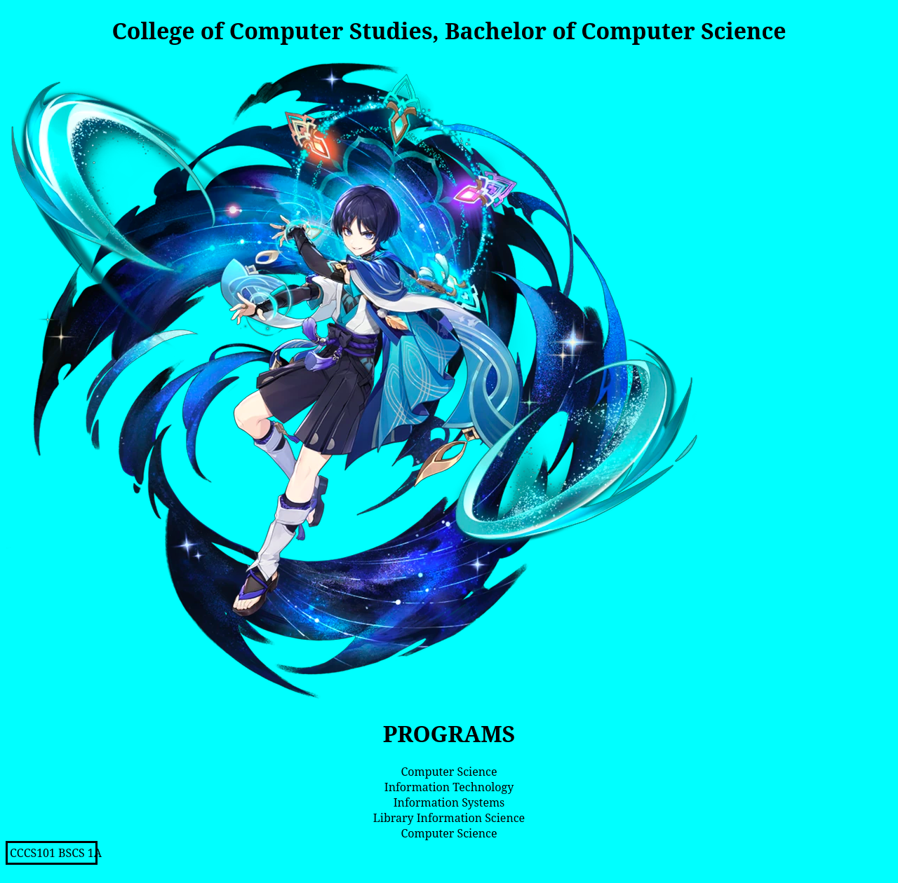

# Activity 1 · College of Computer Studies page

**CCCS 101 · Laboratory Activity 1**

[← Back to all activities](../README.md)

---

## Overview

| | |
|---|---|
| **Date** | 5 – 7 Nov 2023 |
| **Main file** | [`WEBPAGE1.html`](WEBPAGE1.html) |
| **Stack** | HTML5 · embedded CSS |

A static page for the College of Computer Studies, Bachelor of Computer Science, titled "Laboratory 1".

## Features

- Centered page heading over a cyan background
- Feature image (`Wanderer.webp`)
- **PROGRAMS** section with a list of the college's programs
- Class identification table (`CCCS101 · BSCS · 1A`)
- Styles written in an embedded `<style>` block

## Output

Output rendered in headless Firefox.

## Contents

| Path | Description |
|---|---|
| [`WEBPAGE1.html`](WEBPAGE1.html) | The page |
| [`Wanderer.webp`](Wanderer.webp) | Image used on the page |
| [`WandererSmall.png`](WandererSmall.png) | PNG copy of the image (774 × 730) |
| [`SCREENSHOTS/`](SCREENSHOTS/) | Rendered output |

## Run

Open [`WEBPAGE1.html`](WEBPAGE1.html) in a browser. No setup is required.
