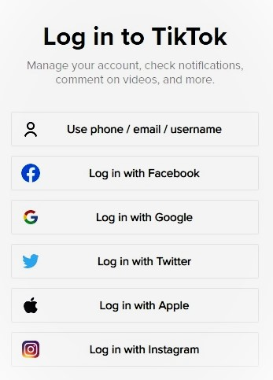
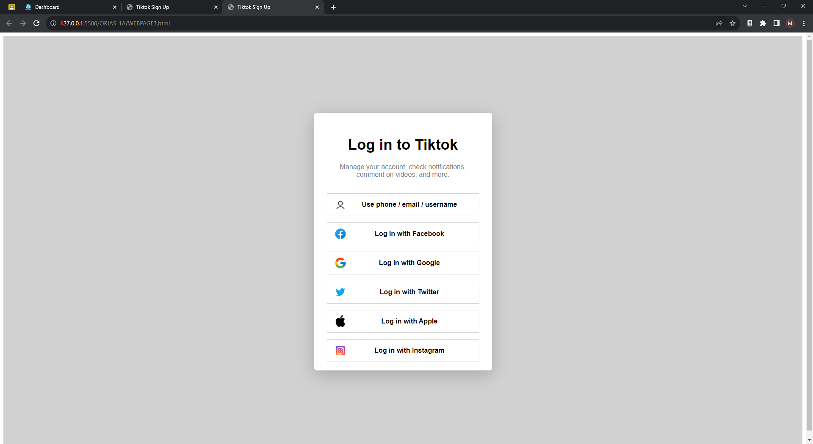
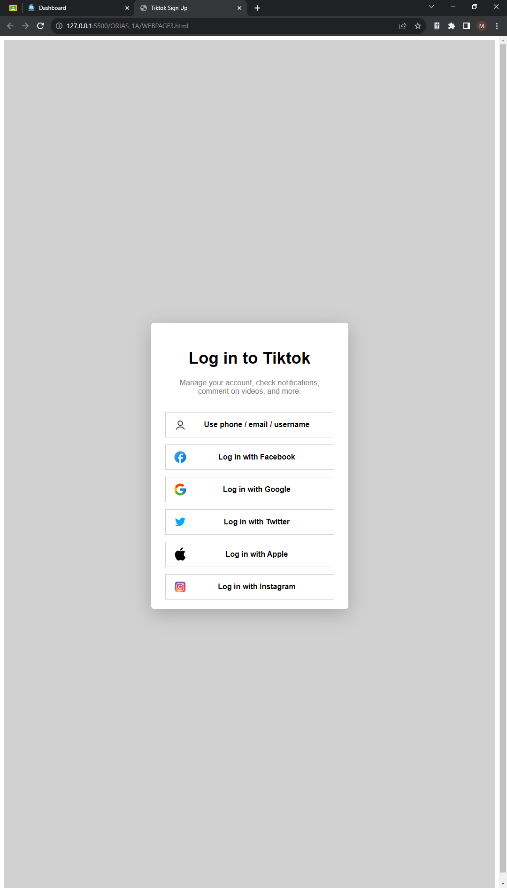
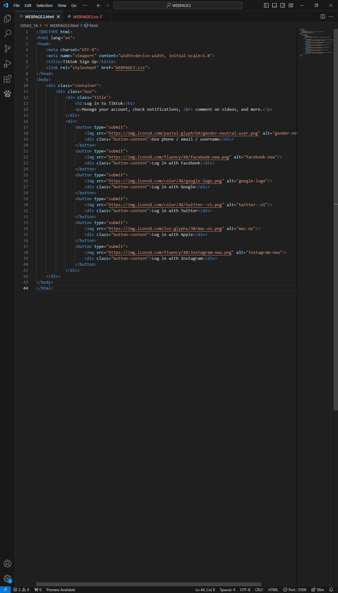
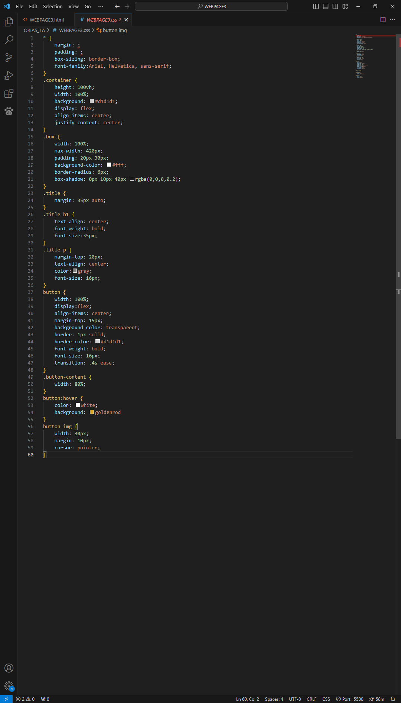

# Activity 3 · TikTok log-in page

**CCCS 101 · Webpage Activity 3**

[← Back to all activities](../README.md)

---

## Overview

| | |
|---|---|
| **Date** | 20 – 21 Nov 2023 (opened 20 Nov, due 21 Nov) |
| **Main files** | [`WEBPAGE3.html`](ORIAS_1A/WEBPAGE3.html) · [`WEBPAGE3.css`](ORIAS_1A/WEBPAGE3.css) |
| **Stack** | HTML5 · CSS3 · Flexbox · icons8 |

A recreation of TikTok's "Log in to TikTok" dialog from a reference image.

## Features

- Title and subtitle above six full-width login options: phone / email / username, Facebook, Google, Twitter, Apple and Instagram
- Card limited to `max-width: 420px` with a soft shadow, centered with Flexbox
- Each button is a Flexbox row: fixed-size icon on the left, centered label
- `transition: .4s ease` with a goldenrod hover colour
- Layout holds in both landscape and portrait windows
- Icons load from [icons8](https://icons8.com/), so an internet connection is needed

## Output

| Reference | Output · landscape | Output · portrait |
|:-:|:-:|:-:|
|  |  |  |

<b>Code screenshots</b>

 

| HTML | CSS |
|:-:|:-:|
|  |  |

## Contents

| Path | Description |
|---|---|
| [`ORIAS_1A/`](ORIAS_1A/) | Submission: `WEBPAGE3.html`, `WEBPAGE3.css` and an icon-source reminder |
| [`TASK/`](TASK/) | Directions, task info and the reference image |
| [`SCREENSHOTS/`](SCREENSHOTS/) | HTML, CSS and output screenshots (landscape and portrait) |

## Run

Open [`ORIAS_1A/WEBPAGE3.html`](ORIAS_1A/WEBPAGE3.html) in a browser, or serve the folder with the VS Code **Live Server** extension.

> [!NOTE]
> The page loads its icons from icons8, so open it while online.
