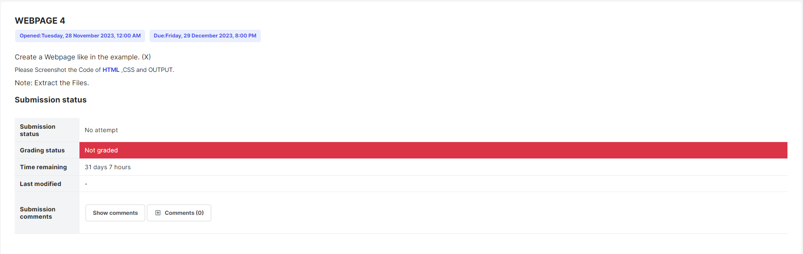
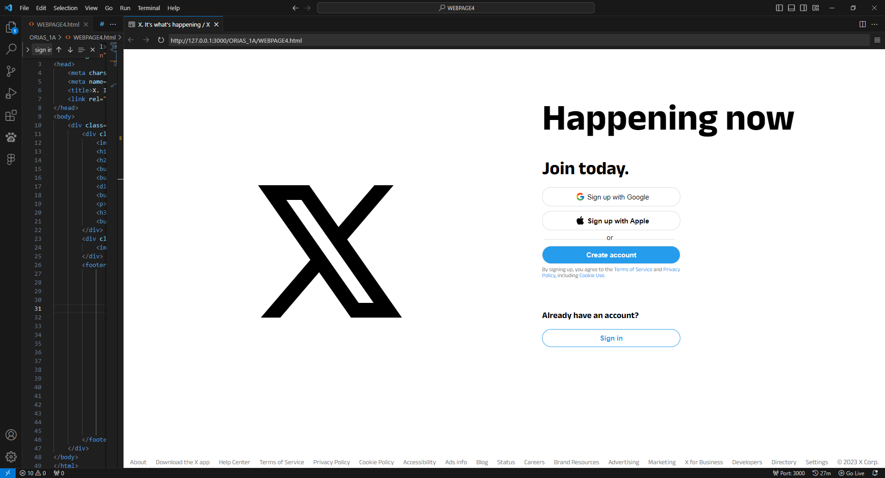
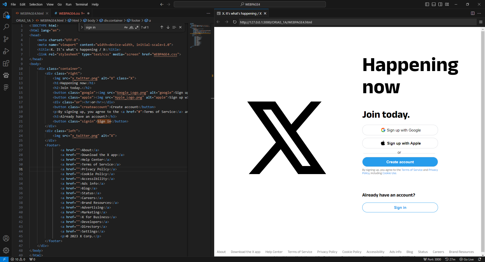
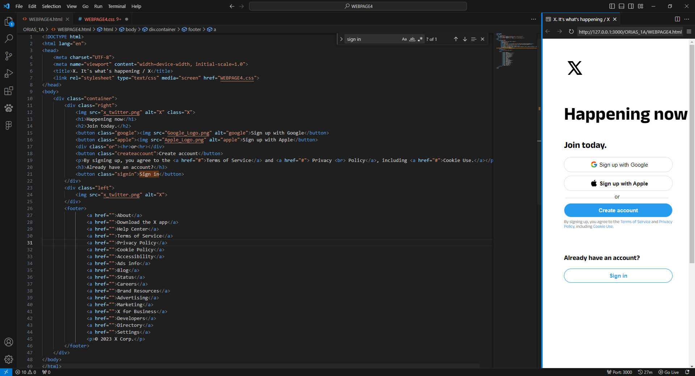
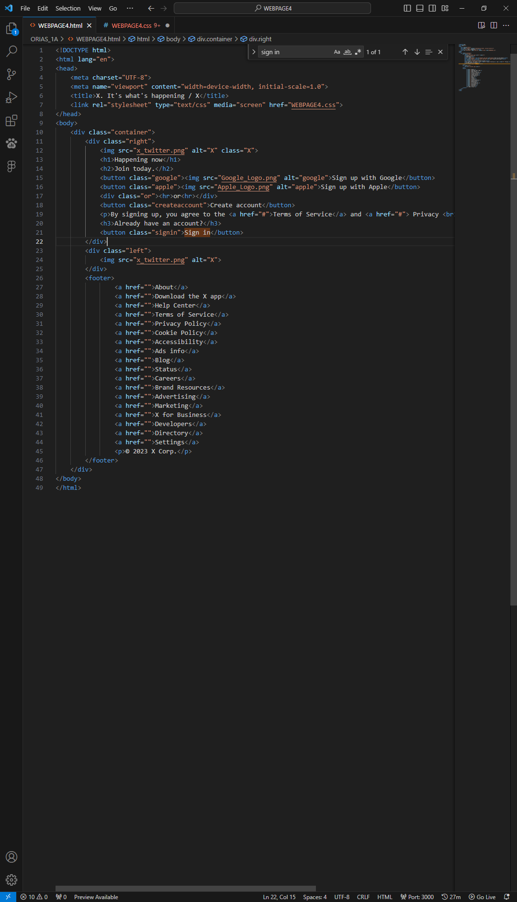
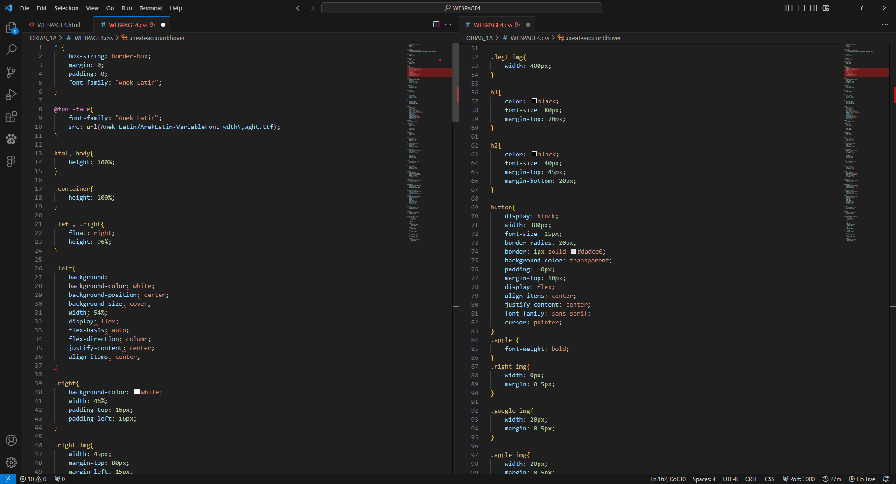
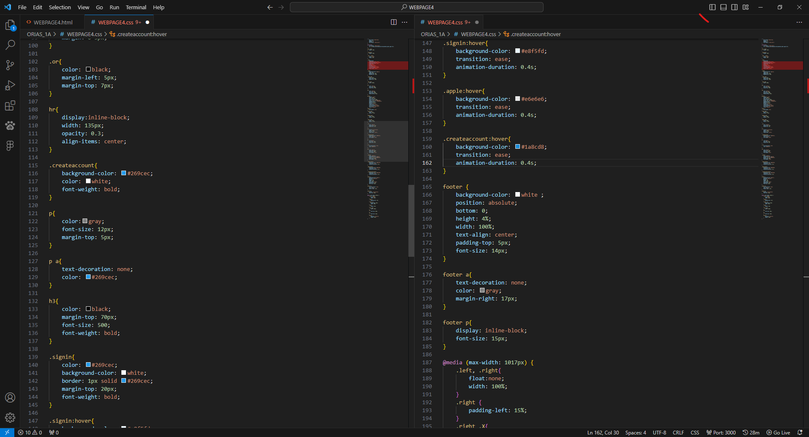
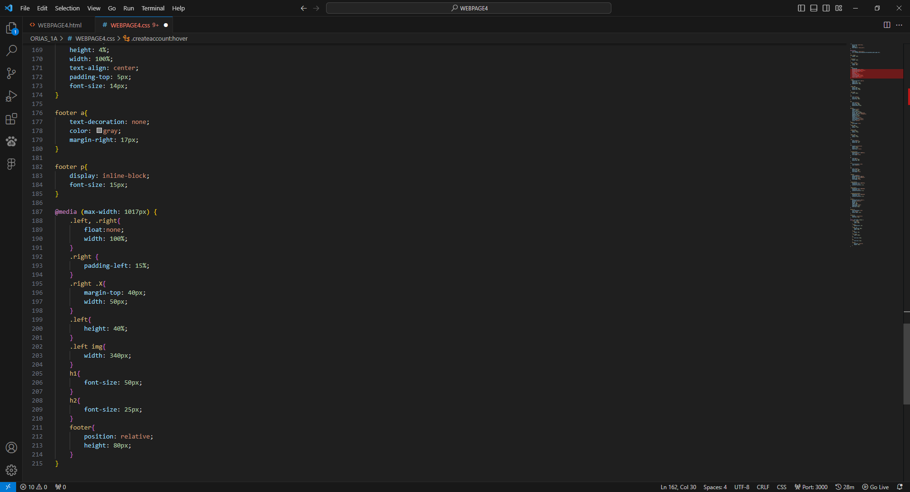

# Activity 4 · X landing page

**CCCS 101 · Webpage Activity 4**

[← Back to all activities](../README.md)

---

## Overview

| | |
|---|---|
| **Date** | 28 – 29 Nov 2023 (opened 28 Nov, due 29 Dec); redo on 5 Dec 2023 |
| **Main files** | [`WEBPAGE4.html`](ORIAS_1A/WEBPAGE4.html) · [`WEBPAGE4.css`](ORIAS_1A/WEBPAGE4.css) |
| **Stack** | HTML5 · CSS3 · Flexbox · Media queries · Anek Latin font |

The X (formerly Twitter) logged-out landing page with a responsive layout.

## Features

- Two-column layout: large X logo on the left, **"Happening now / Join today."** sign-up column on the right
- *Sign up with Google* and *Sign up with Apple* buttons with logos, an "or" divider, a blue *Create account* button and an outlined *Sign in* button
- Terms notice and the full footer link row
- Anek Latin variable font loaded locally with `@font-face`
- `@media (max-width: 1017px)` breakpoint that stacks the columns and resizes the logo, headings and footer
- [`REDO/`](REDO/): alternate layout scaffold (`Home.html`, `styles.css`) with its own icons

## Output

| Task prompt | Output · desktop |
|:-:|:-:|
|  |  |

| Output · responsive (1) | Output · responsive (2) |
|:-:|:-:|
|  |  |

<b>Code screenshots</b>

 

| HTML | CSS (1) | CSS (2) | CSS (3) |
|:-:|:-:|:-:|:-:|
|  |  |  |  |

## Contents

| Path | Description |
|---|---|
| [`ORIAS_1A/`](ORIAS_1A/) | Submission: `WEBPAGE4.html`, `WEBPAGE4.css`, logos and the Anek Latin font |
| [`REDO/`](REDO/) | Alternate layout scaffold (`Home.html`, `styles.css`, `icons/`) |
| [`SCREENSHOTS/`](SCREENSHOTS/) | HTML, CSS, output and responsive-output screenshots |
| [`TASK.png`](TASK.png) | Task prompt |

## Run

Open [`ORIAS_1A/WEBPAGE4.html`](ORIAS_1A/WEBPAGE4.html) in a browser, or serve the folder with the VS Code **Live Server** extension. Resize the window below 1017 px wide to see the responsive layout.
